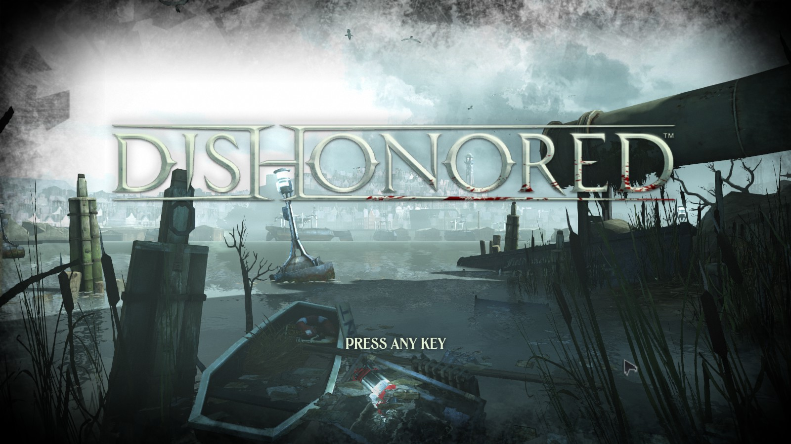

<div align=center>

</div>

---

Static recompilation of the Xbox 360 version of Dishonored (2012) using rexglue-sdk.

The project is fully vibecoded.

The end goal is to port the game to the Switch, but this repo is released as a rexglue-sdk recipe for recompiling and playing your **legally owned and purchased** Xbox 360 copy of Dishonored on PC, using emulated Xbox 360 rendering.

Work in progress: the game compiles, boots and renders the main menu correctly. Gameplay has not been tested yet.

Contributions that make the PC version run better, such as a native renderer, are welcome and appreciated.

### Instructions

Requirements: Linux, clang-20, CMake 3.25+, Ninja, a Vulkan GPU.

1. Clone the repo with its submodules. rexglue-sdk is pinned to upstream commit `bd833a2`
   in `thirdparty/rexglue-sdk`. Then apply the SDK patches:

   ```bash
   git clone --recursive <this repo's URL> dishonored-nx
   cd dishonored-nx
   tools/apply_patches.sh
   ```

2. Extract your copy of the game (`default.xex` and its data files) into
   `dishonored-extract/` (it is gitignored). Only the `default.xex` with SHA-256
   `c8338325b538cbb917ff9da8b61929f5c6cd55697edc798a4723371b368db858`
   (Title ID 425307E3, built 2012-08-18) is supported.

   ```text
   dishonored-nx/
     dishonored-extract/
       default.xex
     thirdparty/rexglue-sdk/
   ```

3. Build. The SDK is built as part of the project. The first build runs codegen
   (about 10 minutes) and then compiles the recompiled game, which takes a while.

   ```bash
   cmake --preset linux-amd64-release
   cmake --build --preset linux-amd64-release
   ```

4. Run:

   ```bash
   tools/run.sh
   ```

   The script removes guest memory segments left in `/dev/shm` by crashed runs and selects
   the NVIDIA GPU on hybrid laptops. Runtime settings are in `config/dishonored.toml`.

### Changes

rexglue-sdk patches (`patches/`, on top of upstream `bd833a2`):

| Patch | What was wrong | Effect in game | Source |
|---|---|---|---|
| `0001` | On GPUs without `VK_EXT_shader_stencil_export` (NVIDIA), stencil copies between render targets never discarded pixels, so stencil saturated at 255 | `0001`–`0003` together removed white noise and outlines on object edges in the main menu (not tested one by one) | Xenia Canary `24f90c0ef` |
| `0002` | Texture `exp_adjust` was read from the wrong fetch constant word | See `0001` (in Singularity: white patches flashing over textures) | Upstream PR #490 |
| `0003` | Depth written by pixel shaders was not remapped for float24 depth buffers; UE3 restores scene depth this way | See `0001` (in Singularity: missing water, explosions, title screen vortex) | Xenia Canary `b15fcc73e` |
| `0004` | The achievement popup existed for the whole session, so the window repainted at the monitor rate | FPS counters showed the monitor rate instead of the game's | — |
| `0005` | Occlusion queries were answered with real host queries or a constant fake sample count; Unreal Engine 3 in Dishonored then culls meshes that are visible | Main menu without the boat, piers, buoy, reeds and water | Xenia Canary `b447699a5` |

Config (`config/dishonored.toml`):

| Setting | Effect in game |
|---|---|
| `occlusion_query_enable = false`, `query_occlusion_sample_lower/upper_threshold = 80/100` | Fake occlusion results cycling 100..80 (patch `0005`), so visible meshes are drawn |
| `execute_unclipped_draw_vs_on_cpu = true` (Xenia Canary's default) | Lighting: without it the full-screen lighting passes get a wrong screen extent and objects are drawn dark, unlit |
| `readback_memexport = false`, `clear_memory_page_state = false` (Xenia Canary's defaults) | The CPU does not wait for the GPU after GPU particle effects |
| `vulkan_allow_present_mode_immediate/mailbox = false` | Presents with vsync instead of redrawing the same frame hundreds of times per second |

`overrides.toml` declares 194 function entry points the codegen analyzer misses. Without
them codegen fails, or the game stops with "call to invalid or unregistered function" when one is called.

| Count | How it was found |
|---:|---|
| 6 | Tail-call branch targets, reported by codegen as unresolved calls |
| 188 | Code addresses in the game's data sections (mostly vtables) pointing into gaps between detected functions, found by scanning the loaded image with `tools/find_missing_functions.py` |
